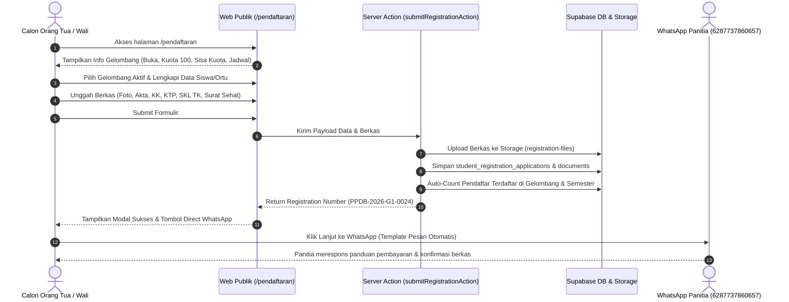

# PRD Modul: Penerimaan Peserta Didik Baru (PPDB) & Manajemen Gelombang

## 1. Ringkasan Modul & Visi Fitur

Modul **Penerimaan Peserta Didik Baru (PPDB)** adalah gerbang utama pendaftaran calon siswa baru di SDIT Fajar. Modul ini dirancang terstruktur, transparan, dan terintegrasi langsung dengan database Supabase serta penyimpanan berkas *private storage*.

### Karakteristik & Fitur Kunci:
1. **Siklus Gelombang Fleksibel (CRUD Gelombang 1, 2, dan 3)**:
   - Sekolah dapat membuka beberapa gelombang pendaftaran (umumnya Gelombang 1, Gelombang 2, dan Gelombang 3) pada setiap periode/semester pendaftaran.
   - Setiap gelombang memiliki tanggal pembukaan, tanggal penutupan, kuota target murid (default: **100 murid**), jadwal tes/observasi pemetaan, dan pengumuman hasil.
2. **Auto-Count Pendaftar & Sisa Kuota Real-Time**:
   - Pendaftar yang berhasil mengirimkan formulir otomatis terhitung ke dalam data gelombang & semester tersebut (`registered_count`).
   - Sisa kuota dihitung dan ditampilkan secara transparan:
     $$\text{Sisa Kuota} = \text{Target Kuota (100)} - \text{Total Pendaftar Terdaftar}$$
3. **Formulir Pendaftaran Lengkap & Unggah Berkas Persyaratan**:
   - Formulir multi-tahap (*stepper*) ramah orang tua dengan validasi ketat Zod.
   - Mencakup seluruh berkas administrasi yang dipersyaratkan oleh sekolah.
   - Berkas tersimpan di Supabase Storage bucket privat (`registration-files`) dengan referensi URL/path di PostgreSQL.
4. **Popup Lanjutan Pembayaran via WhatsApp**:
   - Pasca-submit, sistem menampilkan popup/modal konfirmasi sukses pendaftaran.
   - Terdapat tombol langsung yang mengarahkan pendaftar ke WhatsApp resmi panitia PPDB (`+62 877-3786-0657`) dengan template pesan otomatis untuk konfirmasi informasi pembayaran formulir.
5. **Pengelolaan Eksklusif oleh Admin & Super Admin**:
   - Akses verifikasi dokumen pendaftaran menggunakan *Secure Signed URL*.
   - Seleksi status penerimaan calon siswa (*submitted*, *under_review*, *approved*, *rejected*).
   - Promosi calon siswa yang disetujui ke tabel siswa aktif (`students`) saat tahun ajaran baru dimulai (PPDB Staging Architecture).

---

## 2. Struktur Gelombang PPDB (`admission_waves`)

### A. Konsep Gelombang per Periode / Semester
Pendaftaran PPDB terikat pada entitas `academic_years` (Tahun Ajaran tujuan penerimaan siswa, misal `2026/2027`) dan `semesters` (Semester pendaftaran berjalan):

| Gelombang | Target Peserta & Tujuan | Periode Umum | Kuota Default |
|---|---|---|---|
| **Gelombang 1** | Jalur Indent / Prestasi / Alumni TK-RA Fajar & Mitra | Oktober ?" Desember | 100 Murid |
| **Gelombang 2** | Jalur Reguler Umum | Januari ?" Maret | 100 Murid (atau sisa kuota) |
| **Gelombang 3** | Jalur Pemenuhan Kuota Akhir (jika kuota belum terpenuhi) | April ?" Juni | Sesuai sisa kuota tersedia |

*Catatan*: Admin atau Super Admin dapat menambah, mengubah kuota (misal diubah menjadi 80 atau 120), serta mengaktifkan/menonaktifkan gelombang kapan saja sesuai kebutuhan penerimaan sekolah.

### B. Atribut Informasi Setiap Gelombang
Setiap gelombang menyajikan informasi publik dan administratif:
1. **Nama Gelombang**: Contoh *"Gelombang 1 - Jalur Prestasi & Khusus"*.
2. **Tahun Ajaran & Semester**: Keterikatan periode aktif.
3. **Tanggal Pembukaan (`start_date`)**: Hari dan jam form mulai menerima pendaftaran.
4. **Tanggal Penutupan (`end_date`)**: Batas akhir pengisian formulir dan unggah berkas.
5. **Target Kuota Penerimaan (`quota`)**: Default 100 siswa.
6. **Total Pendaftar Masuk (`registered_count`)**: Terhitung otomatis saat pendaftar melakukan submit.
7. **Sisa Kuota Tersedia (`remaining_quota`)**: Selisih kuota target dengan pendaftar aktif.
8. **Jadwal Tes / Observasi (`observation_date`)**: Tanggal pemetaan kematangan belajar & baca Al-Qur'an anak.
9. **Tanggal Pengumuman Kelulusan (`announcement_date`)**: Tanggal pengumuman hasil seleksi.
10. **Biaya Formulir / Pendaftaran (`registration_fee`)**: Informasi nominal biaya pendaftaran.
11. **Status Gelombang**:
    - `draft`: Sedang dipersiapkan oleh admin, belum tampil di publik.
    - `open`: Sedang aktif menerima pendaftaran online.
    - `closed`: Pendaftaran telah ditutup (tenggat waktu habis atau kuota terpenuhi).
    - `archived`: Gelombang periode lampau.

---

## 3. Berkas Persyaratan Pendaftaran Murid Baru

Calon wali murid wajib mengunggah dokumen digital dalam format **PDF, JPG, atau PNG** (ukuran maksimal 5MB per berkas). Dokumen disimpan di bucket Supabase Storage privat `registration-files`:

| No | Dokumen Berkas | Keterangan & Ketentuan | Sifat |
|---|---|---|---|
| 1 | **Pas Foto Formal Calon Murid** | Pas foto berwarna terbaru ukuran 3x4 (latar merah atau biru), format gambar JPG/PNG. Maks 2MB. | **Wajib** |
| 2 | **Akta Kelahiran Calon Siswa** | Scan/foto jelas dokumen asli Akta Kelahiran dari Disdukcapil untuk verifikasi nama dan tanggal lahir. | **Wajib** |
| 3 | **Kartu Keluarga (KK)** | Scan/foto asli Kartu Keluarga terbaru yang memuat nama calon siswa dan orang tua. | **Wajib** |
| 4 | **KTP Kedua Orang Tua / Wali** | Scan/foto KTP Ayah dan Ibu (atau Wali sah). Dapat diunggah terpisah atau dijadikan 1 file PDF. | **Wajib** |
| 5 | **Ijazah / SKL / Surat Keterangan Aktif TK** | Surat Keterangan Lulus (SKL) dari TK/RA atau Surat Keterangan Aktif Belajar di kelompok B. | **Wajib** |
| 6 | **Surat Keterangan Sehat & Imunisasi** | Surat dokter/Puskesmas atau fotokopi buku KIA/catatan imunisasi dasar anak. | **Wajib** |
| 7 | **Sertifikat / Piagam Prestasi** | Piagam kejuaraan tahfidz, hafalan hadits, seni, sains, atau olahraga (jika mendaftar via jalur prestasi). | *Opsional* |

---

## 4. Alur Pengguna: Pendaftaran Publik & Popup WhatsApp



### Detail Popup Pasca-Submit:
Setelah tombol *"Kirim Pendaftaran"* ditekan dan validasi berhasil:
1. Modal interaktif Shadcn (`Dialog`) muncul di layar dengan animasi konfirmasi sukses.
2. Menampilkan:
   - **Nomor Registrasi Resmi**: (contoh: `PPDB-2026-G1-0024`).
   - **Nama Calon Siswa**: Nama lengkap yang didaftarkan.
   - **Status Saat Ini**: `Menunggu Pembayaran Formulir & Verifikasi Berkas`.
   - **Tombol Utama (CTA WhatsApp)**:
     - URL Tujuan: `https://wa.me/6287737860657?text=Saya%20sudah%20mendaftar%20online%20dengan%20No%20Pendaftaran%20PPDB-2026-G1-0024%20atas%20nama%20Ahmad%20Fauzan,%20bagaimana%20informasi%20pembayarannya%3F`
     - Teks Tombol: *"Lanjut Konfirmasi ke WhatsApp Panitia"* (dengan ikon WhatsApp hijau).
   - **Tombol Sekunder**: *"Cetak Bukti Pendaftaran"* (membuka tampilan print-friendly `@media print`).

---

## 5. Antarmuka Manajemen Admin & Super Admin

Akses menu PPDB di dashboard admin: `/dashboard/admin/ppdb`.

### A. Sub-Halaman & Fitur:
1. **Ringkasan Analitik PPDB (`/dashboard/admin/ppdb`)**:
   - **StatCard Kuota**: Total Kuota Disediakan (misal 100 murid), Total Formulir Masuk, Berkas Diverifikasi, Calon Siswa Diterima, Sisa Kursi Kosong.
   - **Progress Bar Kuota**: Baris visual interaktif keterisian kursi per gelombang (0 s.d. 100).
   - **Statistik Berkas**: Jumlah dokumen pending, valid, dan perlu revisi.
2. **Kelola Gelombang (`/dashboard/admin/ppdb/gelombang`)**:
   - **Tabel Zebra Cross Gelombang PPDB**: Nomor Gelombang, Judul, Semester/Tahun Ajaran, Rentang Tanggal, Kuota (100), Pendaftar (auto-count), Sisa Kursi, Status Badge (`draft`, `open`, `closed`).
   - **Aksi CRUD**:
     - *Tambah Gelombang Baru*: Modal input data gelombang, penentuan kuota 100 murid, dan tanggal pembukaan/penutupan.
     - *Edit Gelombang*: Penyesuaian tanggal, perpanjangan masa pendaftaran, revisi kuota.
     - *Toggle Buka/Tutup*: Tombol cepat mengaktifkan (`open`) atau menutup (`closed`) pendaftaran gelombang.
     - *Hapus Gelombang*: Pembatasan ketat (*RESTRICT*), hanya dapat dihapus jika pendaftar masih 0.
3. **Data Pendaftar & Verifikasi Berkas (`/dashboard/admin/ppdb/pendaftar`)**:
   - **Tabel Zebra Cross Pendaftar**: No Registrasi, Nama Siswa, Gelombang, Asal TK, Nama Orang Tua, No WhatsApp, Status Berkas, Status Seleksi.
   - **Filter & Pencarian**: Filter per gelombang (1, 2, 3), filter per status (`submitted`, `under_review`, `approved`, `rejected`), pencarian nama/no pendaftaran.
   - **Drawer Detail & Verifikasi Dokumen**:
     - Membuka pratinjau dokumen (foto, akta, KK, KTP, dll.) menggunakan *Signed URL* privat.
     - Opsi tombol per dokumen: *Tandai Sah/Valid* atau *Minta Unggah Ulang* dengan catatan koreksi.
     - Input nilai observasi / tes kematangan siswa.
     - Pengubahan status pendaftaran:
       - `under_review`: Berkas sedang diperiksa panitia.
       - `approved`: Calon siswa dinyatakan **Diterima**.
       - `rejected`: Calon siswa **Tidak Diterima** dengan catatan alasan.
4. **Alur Promosi Siswa Staging ke Siswa Aktif (`students`)**:
   - Tombol *"Promosikan ke Siswa Aktif"* pada calon siswa berstatus `approved`.
   - Mengalokasikan siswa ke rombel kelas 1 baru pada tahun ajaran target.
   - Menghasilkan profil `students`, profil wali murid `parents`, penautan `parent_students`, serta membuat akun login NIS dengan password awal terstruktur `tempatddmmyyyy`.

---

## 6. Spesifikasi Skema Database PostgreSQL (Supabase)

```sql
-- 1. Enum Status Gelombang & Dokumen
create type admission_wave_status as enum ('draft', 'open', 'closed', 'archived');
create type document_verification_status as enum ('pending', 'valid', 'invalid');

-- 2. Tabel Gelombang Pendaftaran (admission_waves)
create table admission_waves (
  id uuid primary key default gen_random_uuid(),
  academic_year_id uuid not null references academic_years(id) on delete restrict,
  semester_id uuid references semesters(id) on delete set null,
  wave_number int not null check (wave_number between 1 and 5), -- 1, 2, 3
  title text not null,                                          -- contoh: 'Gelombang 1 - Jalur Khusus'
  description text,
  start_date date not null,                                     -- Tanggal pembukaan
  end_date date not null,                                       -- Tanggal penutupan
  quota int not null default 100,                               -- Menerima 100 murid
  registration_fee numeric not null default 0,                  -- Biaya formulir (jika ada)
  observation_date date,                                        -- Jadwal tes observasi
  announcement_date date,                                       -- Tanggal pengumuman
  status admission_wave_status not null default 'draft',
  is_active boolean not null default false,
  created_at timestamptz default now(),
  updated_at timestamptz default now()
);

-- Indeks unik: satu nomor gelombang per tahun ajaran
create unique index idx_admission_wave_year_num on admission_waves(academic_year_id, wave_number);

-- 3. Pembaruan Tabel Pendaftaran (student_registration_applications)
-- (Memperkaya kolom biodata calon siswa & relasi ke gelombang)
create table student_registration_applications (
  id uuid primary key default gen_random_uuid(),
  admission_wave_id uuid not null references admission_waves(id) on delete restrict,
  registration_number text not null unique,                      -- contoh: PPDB-2026-G1-0001
  
  -- Biodata Calon Siswa
  student_name text not null,
  nik text,                                                     -- NIK calon siswa
  nisn text,                                                    -- NISN dari TK jika ada
  gender text not null check (gender in ('L', 'P')),
  birth_place text not null,
  birth_date date not null,
  child_number int default 1,
  total_siblings int default 1,
  special_needs text,                                           -- Kebutuhan khusus / riwayat penyakit
  previous_school text,                                         -- Nama TK / RA asal
  
  -- Biodata Orang Tua / Wali
  parent_name text not null,                                    -- Nama Ayah / Wali utama
  father_name text,
  father_nik text,
  father_occupation text,
  father_phone text,
  mother_name text,
  mother_nik text,
  mother_occupation text,
  mother_phone text,
  parent_phone text not null,                                   -- No WhatsApp aktif untuk notifikasi
  parent_email text,
  address text not null,
  
  -- Status Pendaftaran & Penilaian
  status registration_status not null default 'submitted',      -- submitted, under_review, approved, rejected
  observation_score numeric,                                    -- Nilai tes kematangan/tahfidz
  admin_notes text,                                             -- Catatan verifikasi admin
  reviewed_by uuid references profiles(id) on delete set null,
  reviewed_at timestamptz,
  created_at timestamptz default now(),
  updated_at timestamptz default now()
);

-- 4. Pembaruan Tabel Berkas Pendaftaran (student_registration_documents)
create table student_registration_documents (
  id uuid primary key default gen_random_uuid(),
  application_id uuid not null references student_registration_applications(id) on delete cascade,
  document_type text not null,                                  -- pas_foto, akta_kelahiran, kartu_keluarga, ktp_ortu, ijazah_tk, surat_sehat, sertifikat_prestasi
  file_url text not null,
  file_path text not null,                                      -- path di bucket registration-files
  original_filename text not null,
  mime_type text not null,
  file_size bigint not null,
  verification_status document_verification_status not null default 'pending',
  admin_feedback text,
  created_at timestamptz default now()
);
```

### C. Trigger / View Penghitungan Pendaftar & Sisa Kuota
Untuk memastikan performa cepat dan konsistensi data auto-count:
```sql
create or replace view admission_wave_stats as
select 
  w.id as wave_id,
  w.academic_year_id,
  w.semester_id,
  w.wave_number,
  w.title,
  w.quota,
  w.start_date,
  w.end_date,
  w.status,
  w.is_active,
  count(a.id) as registered_count,
  greatest(0, w.quota - count(a.id)) as remaining_quota,
  count(a.id) filter (where a.status = 'approved') as approved_count,
  count(a.id) filter (where a.status = 'under_review') as under_review_count
from admission_waves w
left join student_registration_applications a on a.admission_wave_id = w.id
group by w.id;
```

---

## 7. Kebijakan Keamanan Row Level Security (RLS)

1. **Tabel `admission_waves`**:
   - `SELECT`: Diizinkan untuk publik (`anon` dan `authenticated`) jika status adalah `'open'` dan `is_active = true`. Role `admin` dan `super_admin` dapat melihat semua data gelombang.
   - `INSERT`, `UPDATE`, `DELETE`: Hanya diizinkan untuk role `admin` dan `super_admin`.
2. **Tabel `student_registration_applications`**:
   - `INSERT`: Diizinkan untuk publik (`anon`) dengan syarat `admission_wave_id` yang dipilih sedang dalam status `open` dan rentang tanggal valid (`now() between start_date and end_date`).
   - `SELECT`, `UPDATE`: Diizinkan untuk `admin` dan `super_admin`. Publik hanya dapat membaca data ringkas status pendaftaran miliknya melalui Server Action khusus yang memvalidasi nomor pendaftaran dan tanggal lahir.
3. **Tabel `student_registration_documents`**:
   - `INSERT`: Publik dapat mengunggah berkas saat pendaftaran.
   - `SELECT`: Khusus role `admin` dan `super_admin` melalui *Signed URL* privat.
